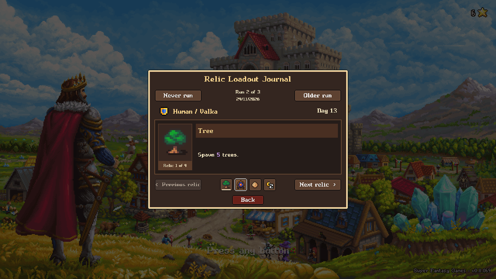
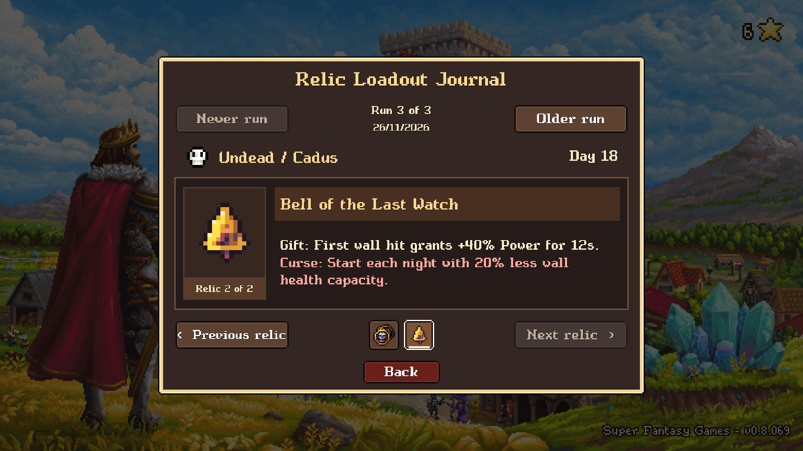

# Relic Loadout Journal

Which relics did your hero carry on their last run? Open **Relic Journal** beside **Play** on the Super Fantasy Kingdom title menu to look through your completed runs and inspect the relics you finished with.

## Features

- **A history for each save profile.** Accepting a run's final result records its kingdom, hero, final day, completion date and held relics. Continuing a save or replaying the same completion keeps one entry for that run.
- **Inspect your final loadout.** Select a relic to see its in-game icon, name, description and any Gift or Curse. The underline marks the relic on display while you move focus to another icon.
- **Readable history when your mods change.** If a relic is missing from your installation, its slot shows a question mark and you can still read its saved ID. The journal stores identifiers and run details locally and looks up artwork in the game.

## How to Use

1. Finish a run with the mod installed and accept its final result. The journal begins with the first completion it sees.
2. On the title menu, choose **Relic Journal**. With a controller, move left from **Play** and confirm. Your most recent run opens first.
3. Choose **Older run** or **Newer run** to browse. Select a relic icon, or use **Previous relic** and **Next relic** to step through the entire loadout.
4. Use the game's **Back** control to return to the title menu with **Relic Journal** focused.

## Screenshots

*At 1×, Tree is selected in Valka’s four-relic loadout.*

*At 1.5×, Bell of the Last Watch shows its Gift and Curse on Cadus’s day-18 record.*

The screenshots were captured on game build 0.8.069.

## Compatibility

Tested on Super Fantasy Kingdom **0.8.070** with [Daybook](https://thunderstore.io/c/super-fantasy-kingdom/p/GKJ/Daybook/), [Weekly Contracts](https://thunderstore.io/c/super-fantasy-kingdom/p/GKJ/WeeklyContracts/), [Cursed Relics](https://thunderstore.io/c/super-fantasy-kingdom/p/GKJ/CursedRelics/) and [Achievement Enabler](https://thunderstore.io/c/super-fantasy-kingdom/p/ownlyme/AchievementEnabler/).

The journal can display relics supplied by content mods while those mods are installed. It keeps the saved ID if a relic later becomes unavailable.

## Installation

Install **RelicLoadoutJournal** by **GKJ** in your Super Fantasy Kingdom profile using a Thunderstore-compatible mod manager, then launch the game with that profile.

For manual installation, install the two BepInEx dependencies listed for this package, then copy `plugins/RelicLoadoutJournal.dll` from the ZIP into `BepInEx/plugins/`. To back up your journal, copy `RelicLoadoutJournal/profile-N` from the game's save directory.
