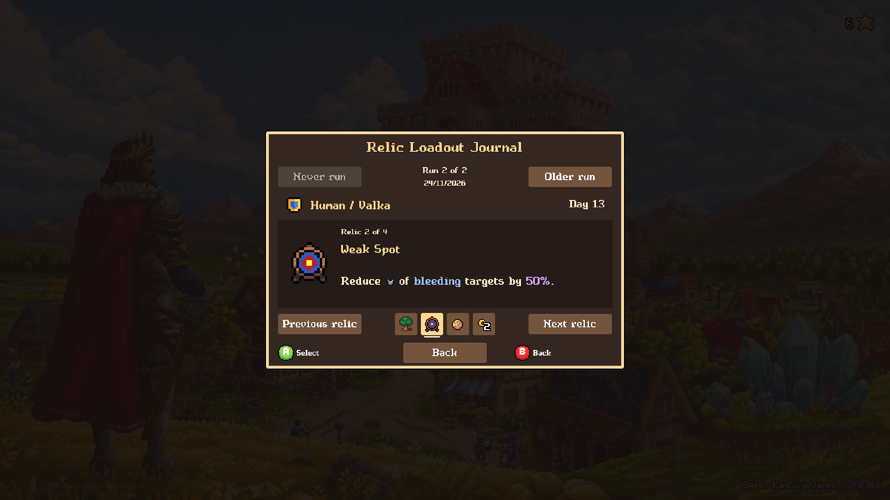
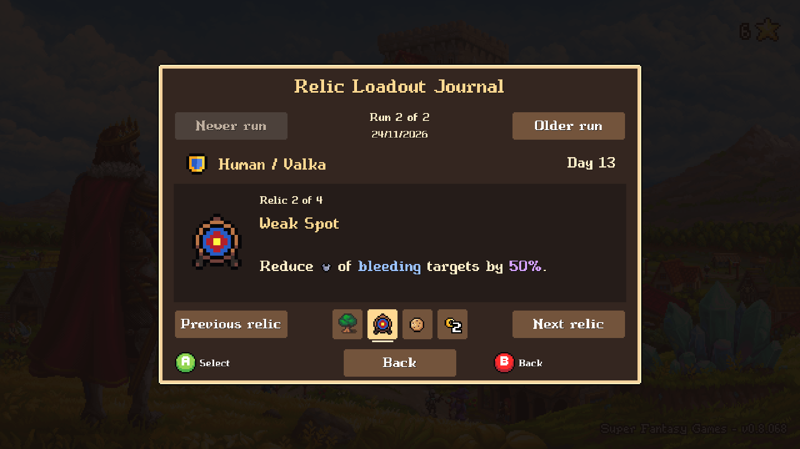

# Relic Loadout Journal

Which relics did your hero carry on their last run? Open **Relic Journal** beside **Play** on the Super Fantasy Kingdom title menu to look through your completed runs and inspect the relics you finished with.

## Features

- **A history for each save profile.** Accepting a run's final result records its kingdom, hero, final day, completion date and held relics. Continuing a save or replaying the same completion keeps one entry for that run.
- **Inspect your final loadout.** Select a relic to see its in-game icon, name and description. The underline marks the relic on display while you move focus to another icon.
- **Readable history when your mods change.** If a relic is missing from your installation, its slot shows a question mark and you can still read its saved ID. The journal stores identifiers and run details locally and looks up artwork in the game.

## How to Use

1. Finish a run with the mod installed and accept its final result. The journal begins with the first completion it sees.
2. On the title menu, choose **Relic Journal**. With a controller, move left from **Play** and confirm. Your most recent run opens first.
3. Choose **Older run** or **Newer run** to browse. Select a relic icon, or use **Previous relic** and **Next relic** to step through the entire loadout.
4. Use the game's **Back** control to return to the title menu with **Relic Journal** focused.

## Screenshots

*At 1× scale, Valka's day-13 record shows all four relics. Weak Spot is the second icon in the row.*

*At 1.5× scale, the description shows Weak Spot's effect on bleeding targets. The controller prompts along the bottom show Select and Back.*

## Compatibility

- Works with Super Fantasy Kingdom **0.8.068** and the other [GKJ mods](https://thunderstore.io/c/super-fantasy-kingdom/p/GKJ/).
- [Cursed Relics](https://thunderstore.io/c/super-fantasy-kingdom/p/GKJ/CursedRelics/) and [More Relics](https://thunderstore.io/c/super-fantasy-kingdom/p/ownlyme/MoreRelics/) relics can be shown while their content mods are installed. Existing entries keep an unavailable relic’s ID if you remove the mod that supplied it.
- The journal records runs when you accept the final result. Each game profile has its own history. It can share a profile with [Daybook](https://thunderstore.io/c/super-fantasy-kingdom/p/GKJ/Daybook/), [Weekly Contracts](https://thunderstore.io/c/super-fantasy-kingdom/p/GKJ/WeeklyContracts/), and [Achievement Enabler](https://thunderstore.io/c/super-fantasy-kingdom/p/ownlyme/AchievementEnabler/).
- These community mods can share the same profile. [Achievement Enabler](https://thunderstore.io/c/super-fantasy-kingdom/p/ownlyme/AchievementEnabler/), [Bakery Uses Wheat](https://thunderstore.io/c/super-fantasy-kingdom/p/ownlyme/BakeryUsesWheat/), [More Relics](https://thunderstore.io/c/super-fantasy-kingdom/p/ownlyme/MoreRelics/), [Right Click Skip](https://thunderstore.io/c/super-fantasy-kingdom/p/ownlyme/RightClickSkip/), and [Tavern Food Priorities](https://thunderstore.io/c/super-fantasy-kingdom/p/ownlyme/TavernFoodPriorities/).

## Installation

Install **RelicLoadoutJournal** by **GKJ** in your Super Fantasy Kingdom profile using a Thunderstore-compatible mod manager, then launch the game with that profile.

For manual installation, install the two BepInEx dependencies listed for this package, then copy `plugins/RelicLoadoutJournal.dll` from the ZIP into `BepInEx/plugins/`. To back up your journal, copy `RelicLoadoutJournal/profile-N` from the game's save directory.

## Support

[Support GKJ Games on Ko-fi](https://ko-fi.com/gkj_games)
